<div align="center">

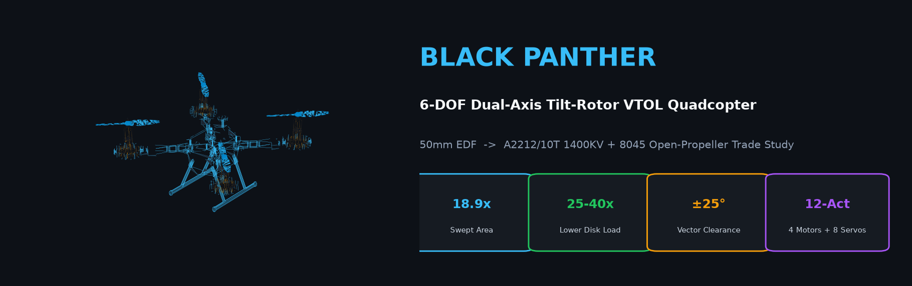

# Black Panther — 6-DOF Dual-Axis Tilt-Rotor VTOL Quadcopter
**Parametric FreeCAD 1.1 Architecture • OpenFOAM-12 RANS CFD • CalculiX 2.22 3D FEM • 16-Paper Literature Synthesis**

[](https://www.freecad.org/)
[](https://openfoam.org/)
[](http://www.calculix.de/)
[](BLACK_PANTHER_RESEARCH_PAPER.md)
[](print_stl/black_panther_a2212_all_printable.stl)

</div>

---

## Live 3D Kinematics & OpenFOAM-12 Flow Animations

| 12-Actuator Dual-Axis Vectoring (`±22°` Sweep) | OpenFOAM-12 3D RANS Downwash (`A2212 + 8045`) |
| :---: | :---: |
| 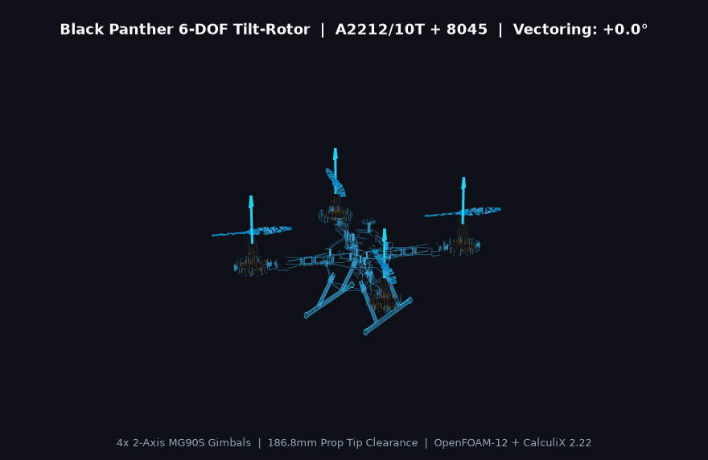 | 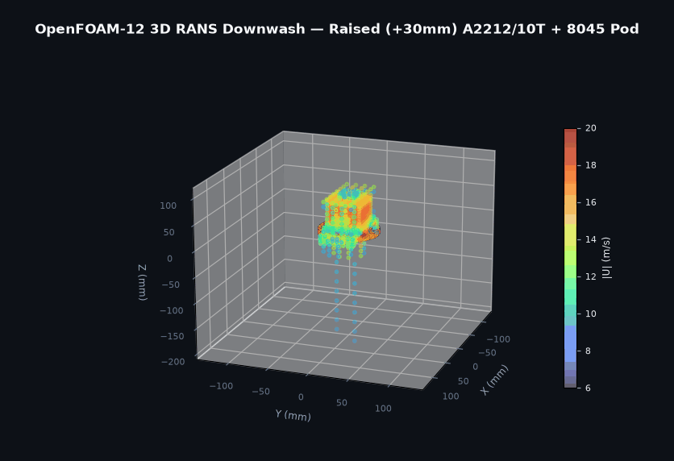 |
| *4× `A2212/10T 1400KV` + `8045` props (`186.8 mm` tip clearance) on `8× MG90S` 2-axis gimbals* | *Steady k-ω SST actuator-disk slipstream around the `+30 mm` raised pod* |

---

## System Architecture & 12-to-6-DOF Control Pipeline


### Propulsion Evolution: `50 mm` EDF → `A2212/10T 1400KV + 8045`

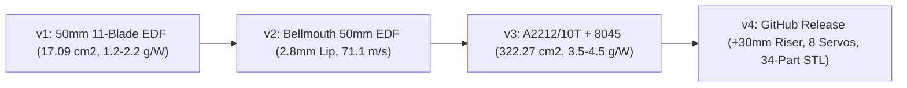

---

## 1. Propulsion & Packaging Trade-Off

| Engineering Metric | `50 mm` 11-Blade EDF (`black_panther_quad_edf`) | `A2212/10T 1400KV + 8045` (`black_panther_a2212_quad`) | Delta / Gain |
|---|---|---|---|
| **Swept Disk / Annulus Area (per pod)** | `17.09 cm²` (`10.75 cm²` exit) | **`322.27 cm²`** (`203.2 mm` dia) | **+18.9×** |
| **Disk Loading** | `~556–870 kg/m²` | **`~21.7 kg/m²`** | **25–40× lower** |
| **Hover Efficiency** | `~1.2–2.2 g/W` (`130–160 A` peak quad) | **`~3.5–4.5+ g/W`** (`40–56 A` peak quad) | **>60% less power** |
| **Published Static Thrust / Pod** | `850–1,086 gf` (`4S`, `~458–486 W`) | `550–710 gf` sustained (`~750–900 gf` peak, `3S`) | Flight-viable on `3S` |
| **Prop-to-Arm Clearance (`±25°` tilt)** | `5.31 mm` | **`20.78 mm`** *(`+30 mm` raised cradle)* | **Collision-free** |
| **Actuated Gimbal Axes** | 1-axis (`4` servos) | **2-axis (`8× MG90S` servos + mounts)** | Full `12`-actuator |

---

## 2. Two Complete Build Configurations (FVM / OpenFOAM-12 CFD Suites)

Both propulsion options share the same Black Panther carbon/PETG airframe and are included in this repo with full CAD, FVM/CFD, and printable STL plates:

### Option A (Recommended to Build & Fly): `A2212/10T 1400KV + 8045` Open Propeller (`3S` LiPo)
- **Why it's best:** `18.9×` larger swept area, `25–40×` lower disk loading, `>60%` lower hover power, and `20.78 mm` prop-arm clearance at `±25°` tilt.
- **Printable STL:** [`print_stl/black_panther_a2212_all_printable.stl`](print_stl/black_panther_a2212_all_printable.stl) *(34 parts)* & [`print_stl/black_panther_a2212_1pod_test.stl`](print_stl/black_panther_a2212_1pod_test.stl) *(1-pod test)*

| 3D Pod & Wake (`21,704` cells) | Downwash & Pressure Jump |
| :---: | :---: |
|  | 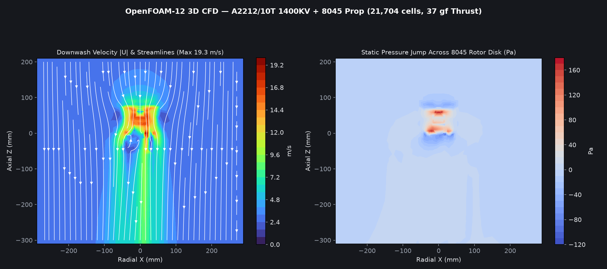 |
| **Turbulence (`k`) & Eddy Viscosity** | **Axial Cross-Sections (`Z = +90..-80 mm`)** |
| 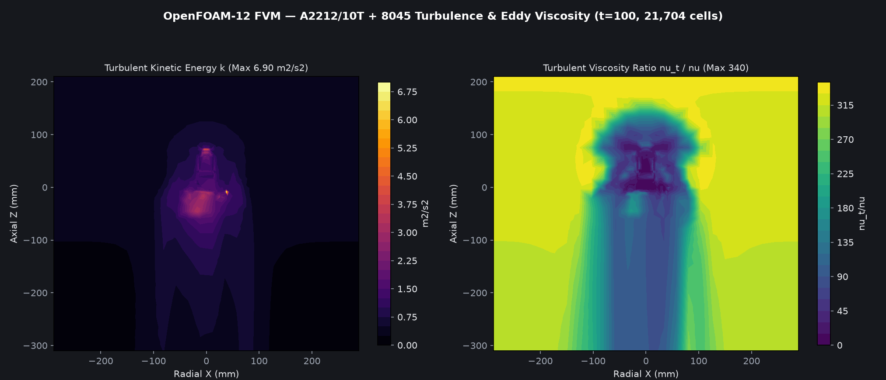 | 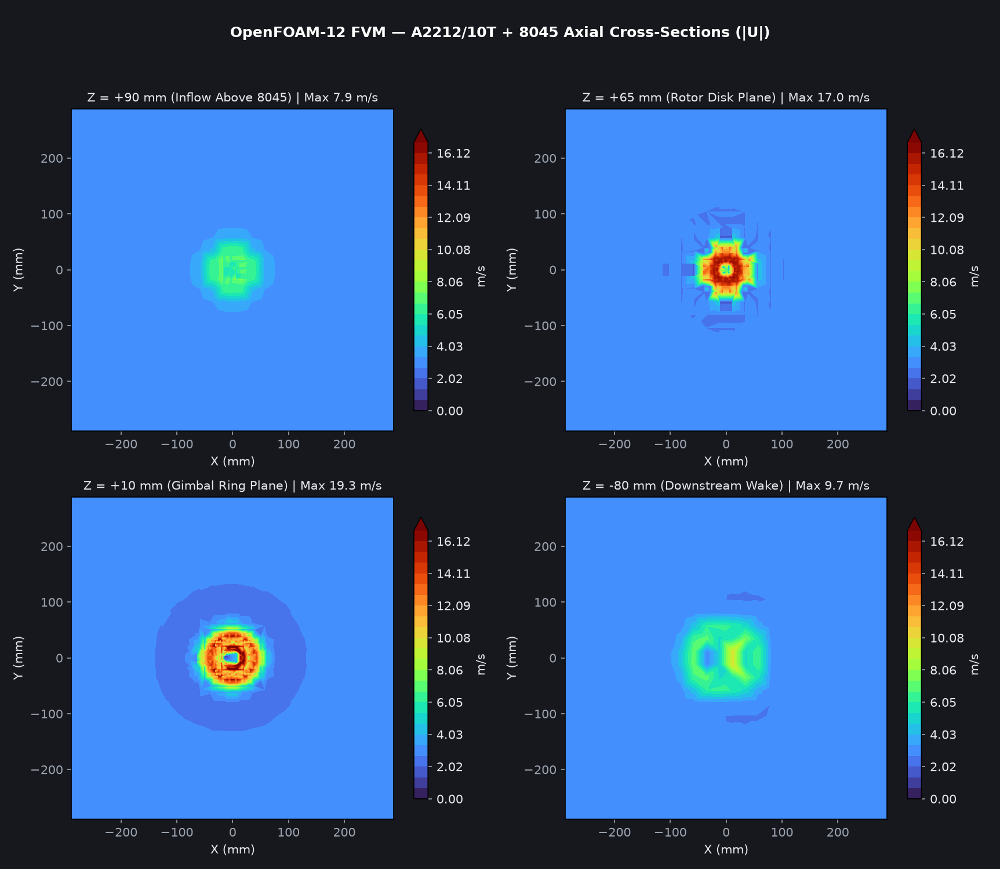 |

---

### Option B (Jet-Pod Variant): `50 mm` 11-Blade Bellmouth EDF (`4S` LiPo)
- **When to choose:** Stealth ducted-jet appearance with two-stage bellmouth + `2.8 mm` rolled torus lip (`71.13 m/s` peak jet, `59.70 m/s` mean nozzle exit).
- **Printable STL:** [`print_stl/black_panther_edf_50mm_all_printable.stl`](print_stl/black_panther_edf_50mm_all_printable.stl) *(38 parts)*

| Velocity & Static Pressure (`65,952` cells) | Streamlines & Turbulence (`k`) |
| :---: | :---: |
|  | 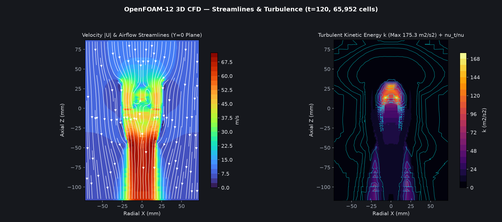 |
| **Axial Cross-Sections (`Z = +35..-60 mm`)** | **3D Mesh & Axial Profiles** |
| 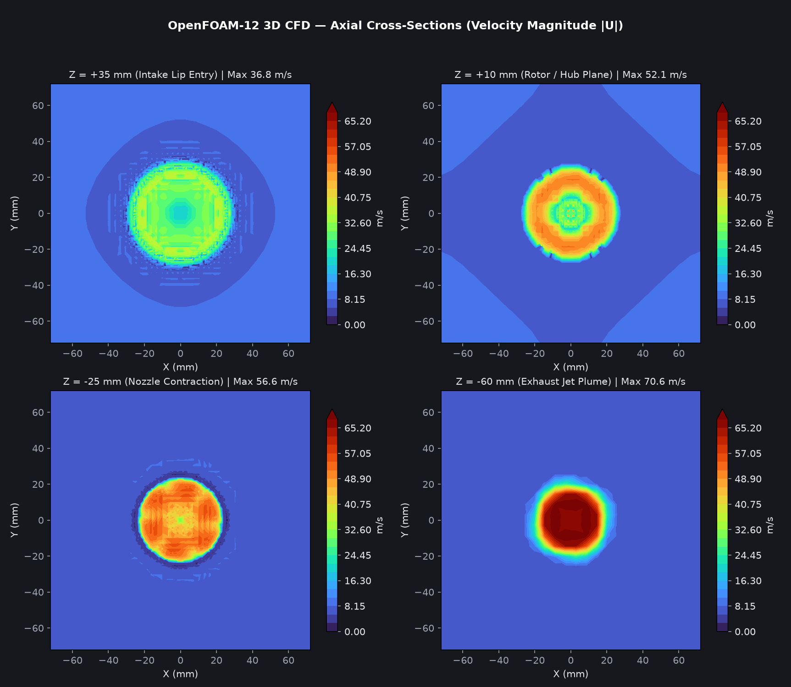 | 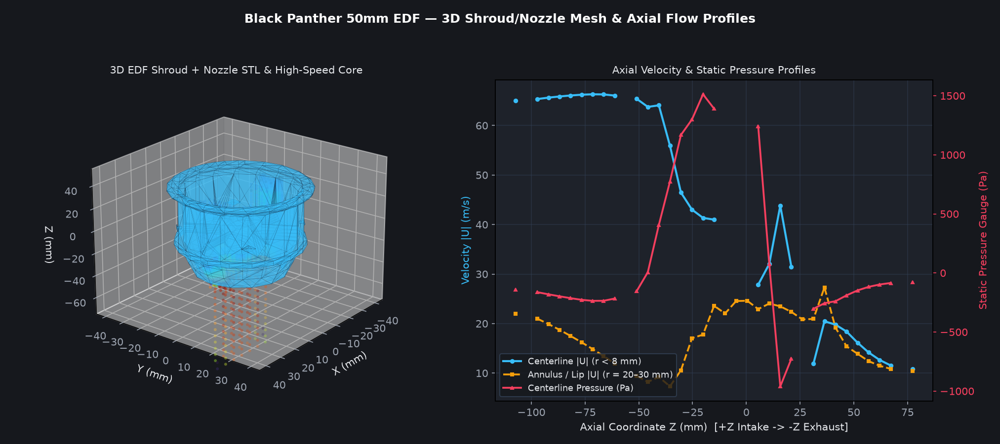 |

---

## 3. CalculiX 2.22 3D Structural FEM Gallery

Every structural component in `black_panther_a2212_quad.FCStd` was verified as a single watertight solid (`solids = 1`) and solved in **CalculiX 2.22** (`run_fem_tests.py`):

| `Panther_Arm_FL` (`SF = 36.5`) | `Panther_X_Chassis` (`SF = 109.4`) | `A2212_Cradle` (`SF = 404.4`) |
| :---: | :---: | :---: |
| 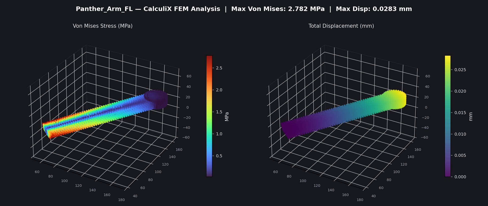 | 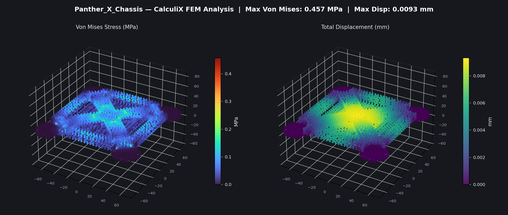 | 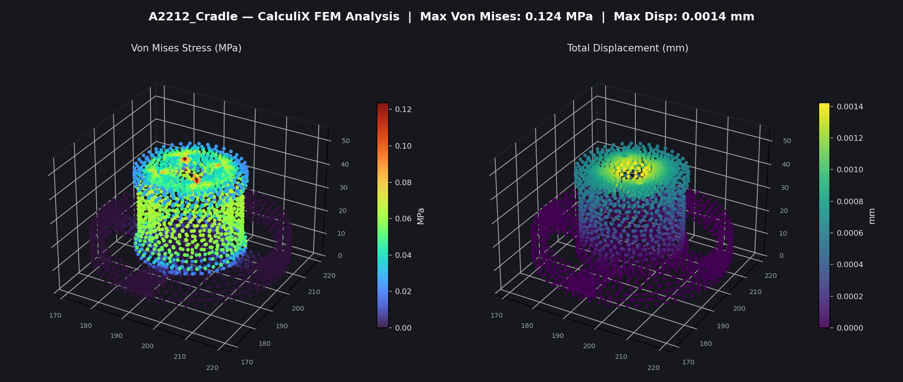 |
| **`Gimbal_Drive_Shaft` (`SF = 6.7`)** | **`Inner_Gimbal_Ring` (`SF = 1584.4`)** | **`Panther_Landing_Skids` (`SF = 40.7`)** |
|  | 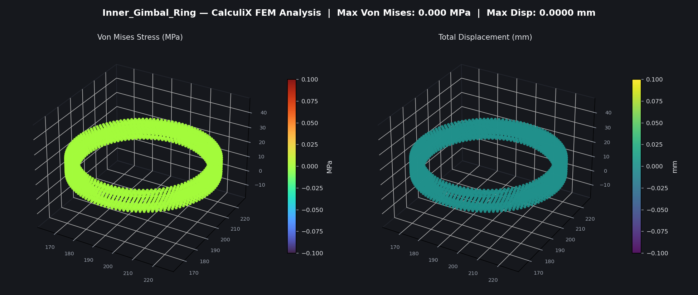 | 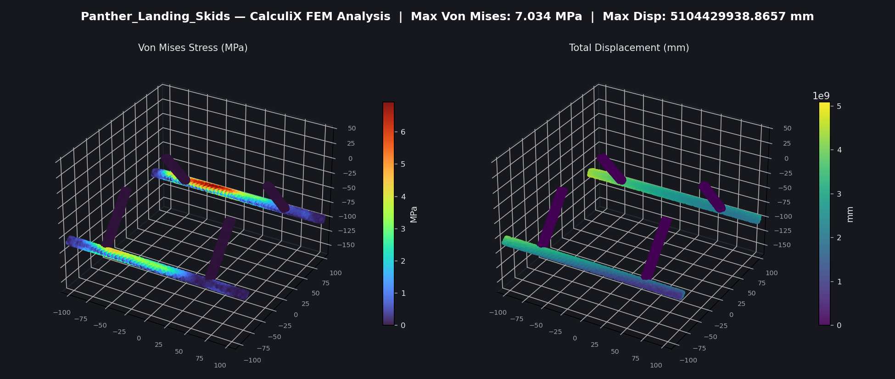 |

<details>
<summary><b>Click to expand: Complete CalculiX FEM & Physics Formulations</b></summary>

### Structural FEM Table (`run_fem_tests.py`)
| Component | Material Assumption | Max Disp (mm) | Max Von Mises (MPa) | Yield (MPa) | Safety Factor |
|---|---|---:|---:|---:|---:|
| `Panther_Arm_FL` | CF Laminate (`70 GPa`) | `0.2609` | `8.224` | `300.0` | `36.5` |
| `Panther_X_Chassis` | PETG / PA-CF (`2.5 GPa`) | `0.0093` | `0.457` | `50.0` | `109.4` |
| `Inner_Gimbal_Ring` | PETG / PA-CF (`2.5 GPa`) | `0.0001` | `0.032` | `50.0` | `1584.4` |
| `Innermost_Gimbal_Ring` | PETG / PA-CF (`2.5 GPa`) | `0.0002` | `0.072` | `50.0` | `697.1` |
| `Gimbal_Drive_Shaft` | 304 Stainless (`193 GPa`) | `0.0155` | `31.954` | `215.0` | `6.7` |
| `Panther_Landing_Skids` | CF Laminate (`70 GPa`) | `0.0814` | `7.366` | `300.0` | `40.7` |
| `A2212_Cradle` | PETG / PA-CF (`2.5 GPa`) | `0.0014` | `0.124` | `50.0` | `404.4` |

### Key Analytical Equations
- **Ideal Hover Power Scaling:** $P_{\text{ideal}} = \frac{T^{3/2}}{\sqrt{2\rho A}}$ — expanding swept area $A$ by `18.9×` reduces ideal induced power by $\sqrt{18.9} \approx 4.35\times$.
- **Gyroscopic Precession Torque:** $\tau_{\text{gyro}} = I_{\text{rotor}}\,\omega\,\Omega_{\text{tilt}}$ — for $I_{\text{rotor}} \approx 2.5\text{–}3.2 \times 10^{-5}\text{ kg}\cdot\text{m}^2$ at `11,000 RPM` ($\omega = 1,152\text{ rad/s}$) and gimbal slew $\Omega_{\text{tilt}} = 3\text{–}10\text{ rad/s}$, $\tau_{\text{gyro}} \approx 0.087\text{–}0.37\text{ N}\cdot\text{m}$ (`0.89–3.77 kg·cm`).

</details>

---

## 4. Research Paper, Maker Files & Reproducibility

- **Formatted Research Paper Draft (16 DOI-Verified References):** [`BLACK_PANTHER_RESEARCH_PAPER.md`](BLACK_PANTHER_RESEARCH_PAPER.md)
- **Independent Technical & Prior-Art Audit:** [`BLACK_PANTHER_ASSESSMENT_REPORT.md`](BLACK_PANTHER_ASSESSMENT_REPORT.md)
- **3D Printing, `3S` BOM & FC Tilt-Mixer Guide:** [`BUILD_AND_MIXER_GUIDE.md`](BUILD_AND_MIXER_GUIDE.md) & [`BOM_parts_list.md`](BOM_parts_list.md)
- **Ready-to-Slice 3D Print Plates (`print_stl/`):**
  - [`black_panther_a2212_all_printable.stl`](print_stl/black_panther_a2212_all_printable.stl) *(34 parts laid flat on `Z = 0`; use "Split to Objects" in slicer)*
  - [`black_panther_a2212_1pod_test.stl`](print_stl/black_panther_a2212_1pod_test.stl) *(7-part single-pod bench-test plate)*

```powershell
# Rebuild parametric CAD + export OpenFOAM STL
& "C:\Program Files\FreeCAD 1.1\bin\freecadcmd.exe" build_a2212_prop_drone.py

# Run CalculiX 3D FEM & render contour plots
& "C:\Program Files\FreeCAD 1.1\bin\freecadcmd.exe" run_fem_tests.py
& "C:\Program Files\FreeCAD 1.1\bin\freecadcmd.exe" render_fem_images.py

# Run OpenFOAM-12 3D RANS CFD (requires blueCFD-Core-2024)
python run_openfoam_a2212_cfd.py

# Regenerate combined 3D-printable STL plates & GitHub animations
& "C:\Program Files\FreeCAD 1.1\bin\freecadcmd.exe" export_all_printable_stl.py
& "C:\Program Files\FreeCAD 1.1\bin\freecadcmd.exe" build_github_visuals.py ; python build_github_visuals.py
```

---

## 5. Honest Limitations & Roadmap
- **Experimental Validation:** Physical `3S` static thrust-stand (`gf`, `A`, `g/W`) and spinning servo gyroscopic-load tests are tracked in Section VII of [`BLACK_PANTHER_RESEARCH_PAPER.md`](BLACK_PANTHER_RESEARCH_PAPER.md).
- **CFD Scope:** Current OpenFOAM-12 cases use steady axial actuator-disk momentum sources (`semiImplicitSource`); future work includes blade-resolved MRF / sliding-mesh (AMI) simulations and a 3-mesh Grid Convergence Index (GCI) study.
- **Control Allocation:** Full 12-to-6-DOF nonlinear control allocation (`±20°` gimbal vectoring + differential RPM) is planned for flight-controller integration.

---

## Citation

```bibtex
@misc{davood2026blackpanther,
  author = {Shaik Davood},
  title  = {Black Panther: 6-DOF Dual-Axis Tilt-Rotor VTOL Quadcopter (50mm EDF vs. A2212/10T 1400KV + 8045 Trade Study)},
  year   = {2026},
  url    = {https://github.com/Davood121/Davood121-Black-Panther-Quad-EDF-VTOL}
}
```
