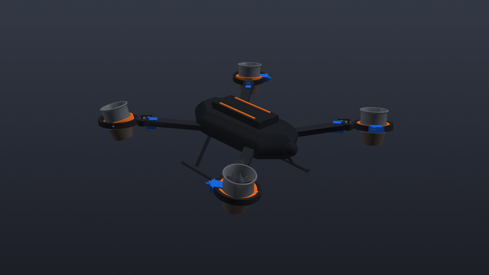
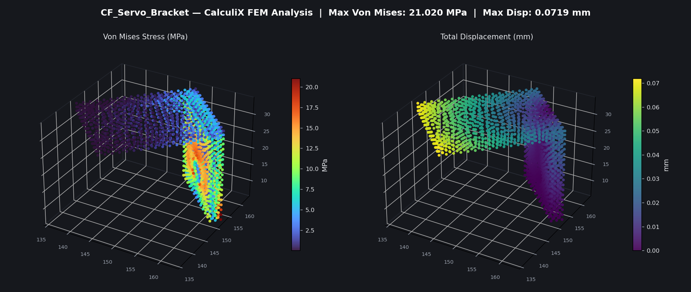

# Black Panther Quad-EDF VTOL Drone

Parametric FreeCAD 1.1+ CAD design, 2-axis thrust-vectoring animation, CalculiX FEM structural analysis, and real-world Bill of Materials for a **50 mm Quad-EDF VTOL Drone** ("Black Panther" stealth frame).



## Features
- **4× 50 mm 2-Axis Gimbaled EDF Thrusters:** Flared intake shroud, 11-blade rotor + spinner, tapered exhaust nozzle, orange inner gimbal ring, black outer gimbal ring, spur-geared drive shaft, carbon-fiber L-bracket, and dual micro-servos per pod.
- **Black Panther Stealth VTOL Frame:** Faceted center fuselage (solidly capped top & bottom), orange dorsal accent trim, twin landing skids, and 4 swept carbon-fiber arms.
- **Live FreeCAD Animation:** `AnimateGimbalEDF.FCMacro` spins all 4 rotors and vectors thrust across all 4 gimbals with Play/Pause, Reset, and Speed controls.
- **Automated CalculiX FEM Suite:** `run_fem_tests.py` meshes and solves key load-bearing parts (`Panther_Arm_FL`, `CF_Servo_Bracket`, `Outer_Gimbal_Ring`, `Gimbal_Drive_Shaft`, `Inner_Gimbal_Ring`, `Panther_Landing_Skids`) and exports 3D Von Mises stress & displacement plots.

## Repository Files
| File | Description |
| :--- | :--- |
| `build_gimbal_edf.py` | Parametric builder for a single 50 mm 2-axis gimbaled EDF unit (`gimbal_edf_50mm.FCStd` / `.step`) |
| `build_black_panther_quad.py` | Full 59-part VTOL quad-EDF assembly (`black_panther_quad_edf.FCStd` / `.step`) |
| `combine_black_panther_quad.py` | Combines all 59 parts into a single solid/compound (`black_panther_quad_edf_combined.FCStd` / `.step` / `.stl`) |
| `AnimateGimbalEDF.FCMacro` | FreeCAD GUI animation macro for 1-pod or 4-pod gimbal & rotor motion |
| `run_fem_tests.py` | Headless Gmsh + CalculiX (`ccx`) structural FEM runner |
| `render_full_model_pic.py` | VTK offscreen 1920×1080 studio renderer (`black_panther_full_parts.png`) |
| `render_fem_images.py` | Renders 3D Von Mises stress & displacement PNGs into `fem_results/` |
| `BOM_parts_list.md` | Real-world parts list, thrust-to-weight budget (~2.5:1), and cost estimate |

## FEM Structural Results
| Part | Material (`E`, Yield) | Max Disp (mm) | Max Von Mises (MPa) | Safety Factor |
| :--- | :--- | :---: | :---: | :---: |
| `Panther_Arm_FL` | Carbon Fiber (70 GPa, 300 MPa) | 0.0283 | 2.782 | 107.8 |
| `CF_Servo_Bracket` | Carbon Fiber (70 GPa, 300 MPa) | 0.0719 | 21.020 | 14.3 |
| `Outer_Gimbal_Ring` | PETG / CF-Nylon (2.5 GPa, 50 MPa) | 0.0001 | 0.016 | 3061.5 |
| `Gimbal_Drive_Shaft` | 304 Stainless (193 GPa, 215 MPa) | 0.0001 | 1.121 | 191.8 |



## Quick Start (FreeCAD 1.1+)
```powershell
# 1. Regenerate CAD assemblies
freecadcmd.exe build_black_panther_quad.py
freecadcmd.exe combine_black_panther_quad.py

# 2. Run FEM analysis & render plots
freecadcmd.exe run_fem_tests.py
freecadcmd.exe render_fem_images.py

# 3. Open in FreeCAD and run AnimateGimbalEDF.FCMacro via Macro -> Macros...
freecad.exe black_panther_quad_edf.FCStd
```
