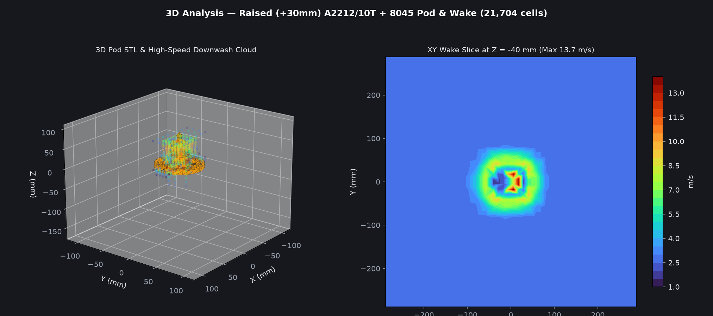
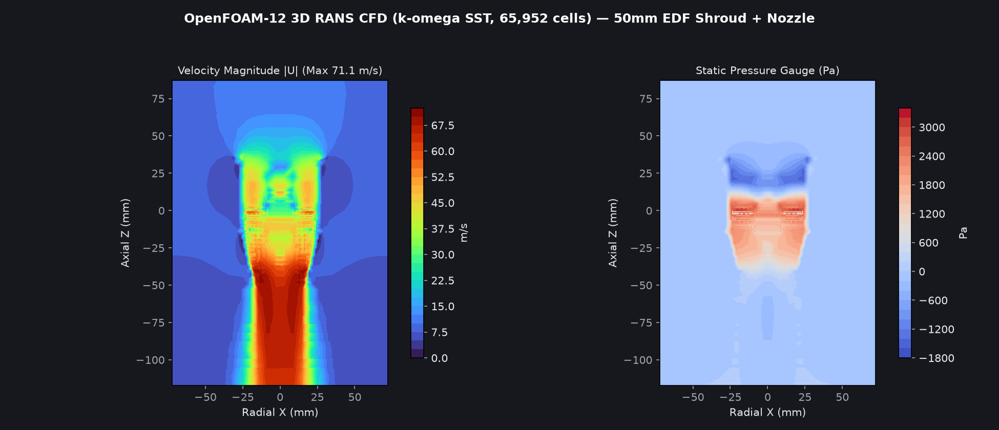

# Black Panther — Dual-Axis Tilt-Rotor Quadcopter (CAD, FEM & OpenFOAM-12 CFD)

[](https://www.freecad.org/)
[](https://openfoam.org/)
[](http://www.calculix.de/)
[](BLACK_PANTHER_RESEARCH_PAPER.md)

**Black Panther** is an open-source parametric engineering and computational trade-study repository for a `551.54 mm` wheelbase **dual-axis (12-actuator) tilt-rotor VTOL quadcopter**, comparing a baseline `50 mm` 11-blade Electric Ducted Fan (EDF) architecture against a high-efficiency **`A2212/10T 1400KV` + `8045` (`203.2 mm`) open-propeller** conversion.

---

## 1. Key Engineering Trade-Off (`50 mm` EDF vs. `A2212/10T 1400KV + 8045`)

| Parameter | Baseline `50 mm` 11-Blade EDF (`black_panther_quad_edf`) | `A2212/10T 1400KV + 8045` (`black_panther_a2212_quad`) |
|---|---|---|
| **Swept Disk / Annulus Area (per pod)** | `17.09 cm²` (`10.75 cm²` nozzle exit) | **`322.27 cm²`** (**18.9× larger**) |
| **Disk Loading** | `~556–870 kg/m²` | **`~21.7 kg/m²`** (**25–40× lower**) |
| **Hover Efficiency** | `~1.2–2.2 g/W` | **`~3.5–4.5+ g/W`** (`>60%` lower hover power) |
| **Recommended Battery** | `4S` LiPo | **`3S` LiPo (`11.1 V`)** *(required for `1400KV + 8045`)* |
| **Prop-to-Arm Clearance (`±25°` tilt)** | `5.31 mm` | **`20.78 mm`** *(`+30 mm` raised `A2212_Cradle`)* |
| **Actuated Gimbal Axes** | 1-axis (`4` servos) | **2-axis (`8× MG90S` servos + `Pitch_Servo_Mount`)** |

---

## 2. 3D OpenFOAM-12 RANS CFD Visualizations

Steady $k$-$\omega$ SST RANS actuator-disk simulations (`foamRun`, `incompressibleFluid`) were executed in **OpenFOAM-12 (`blueCFD-Core-2024`)** on `snappyHexMesh` grids exported directly from FreeCAD:

| Raised (`+30 mm`) `A2212 + 8045` Pod (`21,704` cells) | `50 mm` Bellmouth EDF Pod (`65,952` cells) |
| :---: | :---: |
|  |  |
|  |  |

- **Raised (`+30 mm`) `A2212 + 8045` (`run_openfoam_a2212_cfd.py`):** `|U|_max = 19.33 m/s`, `p ∈ [-183, +174] Pa`, XY wake slice (`Z = -40 mm`) `13.7 m/s` showing concentric gimbal-ring blockage shadow. *(Unraised `22,342`-cell baseline: `|U|_max = 23.31 m/s`, `v_wake = 16.03 m/s`, `7.25 N` / `739 gf` per pod.)*
- **`50 mm` Bellmouth EDF (`run_openfoam_3d_cfd.py`):** `|U|_max = 71.13 m/s`, `v_exit = 59.70 m/s`, `mdot = 0.0786 kg/s`, `p ∈ [-1,641, +3,305] Pa`, two-stage bellmouth + `2.8 mm` rolled torus lip suppressing outer-lip separation.

---

## 3. Structural CalculiX FEM Results (`run_fem_tests.py`)

All 7 structural components from `black_panther_a2212_quad.FCStd` were verified as single watertight solids (`solids = 1`) and solved in **CalculiX 2.22** with explicit `Part::Line` load-direction vectors:

| Component | Max Disp (mm) | Max Von Mises (MPa) | Yield (MPa) | Safety Factor | Contour |
|---|---:|---:|---:|---:|---|
| `Panther_Arm_FL` | `0.2609` | `8.224` | `300.0` | `36.5` | [Plot](fem_results/Panther_Arm_FL_fem.png) |
| `Panther_X_Chassis` | `0.0093` | `0.457` | `50.0` | `109.4` | [Plot](fem_results/Panther_X_Chassis_fem.png) |
| `Inner_Gimbal_Ring` | `0.0001` | `0.032` | `50.0` | `1584.4` | [Plot](fem_results/Inner_Gimbal_Ring_fem.png) |
| `Innermost_Gimbal_Ring` | `0.0002` | `0.072` | `50.0` | `697.1` | [Plot](fem_results/Innermost_Gimbal_Ring_fem.png) |
| `Gimbal_Drive_Shaft` | `0.0155` | `31.954` | `215.0` | `6.7` | [Plot](fem_results/Gimbal_Drive_Shaft_fem.png) |
| `Panther_Landing_Skids` | `0.0814` | `7.366` | `300.0` | `40.7` | [Plot](fem_results/Panther_Landing_Skids_fem.png) |
| `A2212_Cradle` | `0.0014` | `0.124` | `50.0` | `404.4` | [Plot](fem_results/A2212_Cradle_fem.png) |

---

## 4. Repository Structure & Documentation

- **Research & Engineering Documents:**
  - [`BLACK_PANTHER_RESEARCH_PAPER.md`](BLACK_PANTHER_RESEARCH_PAPER.md) — Formatted technical paper draft with 16 DOI-verified references.
  - [`BLACK_PANTHER_ASSESSMENT_REPORT.md`](BLACK_PANTHER_ASSESSMENT_REPORT.md) — Full independent technical soundness, prior-art, and publication-feasibility audit.
  - [`BUILD_AND_MIXER_GUIDE.md`](BUILD_AND_MIXER_GUIDE.md) — 3D printing, `3S` hardware BOM, and ArduPilot/Betaflight tilt-mixer instructions.
  - [`BOM_parts_list.md`](BOM_parts_list.md) — Standardized `3S` Bill of Materials.
- **3D Print-Ready STLs (`print_stl/`):**
  - [`black_panther_a2212_all_printable.stl`](print_stl/black_panther_a2212_all_printable.stl) — All 34 structural/gimbal parts laid flat on `Z = 0` (use *"Split to Objects"* in your slicer).
  - [`black_panther_a2212_1pod_test.stl`](print_stl/black_panther_a2212_1pod_test.stl) — 7-part single-pod bench-test plate.
- **CAD & Simulation Scripts:**
  - `build_a2212_prop_drone.py` / `build_black_panther_quad.py` / `build_gimbal_edf.py` — Parametric FreeCAD 1.1 builders (`*.FCStd` & `*.step`).
  - `run_openfoam_a2212_cfd.py` / `run_openfoam_3d_cfd.py` / `render_more_cfd_images.py` — Automated OpenFOAM-12 CFD & post-processing.
  - `run_fem_tests.py` / `render_fem_images.py` — Automated Gmsh + CalculiX FEM suite.
  - `export_all_printable_stl.py` — Automated build-plate STL packer.

---

## 5. Reproducibility

```powershell
# 1. Rebuild parametric CAD & export OpenFOAM STL
& "C:\Program Files\FreeCAD 1.1\bin\freecadcmd.exe" build_a2212_prop_drone.py

# 2. Run CalculiX 3D FEM suite & render FEM contours
& "C:\Program Files\FreeCAD 1.1\bin\freecadcmd.exe" run_fem_tests.py
& "C:\Program Files\FreeCAD 1.1\bin\freecadcmd.exe" render_fem_images.py

# 3. Run OpenFOAM-12 3D RANS CFD (requires blueCFD-Core-2024 / OpenFOAM-12)
python run_openfoam_a2212_cfd.py

# 4. Export combined 3D-printable STL plates
& "C:\Program Files\FreeCAD 1.1\bin\freecadcmd.exe" export_all_printable_stl.py
```

---

## 6. Known Limitations & Ongoing Work
- **Experimental Validation:** Static thrust-stand (`gf`, `A`, `g/W` on `3S`) and spinning servo gyroscopic-load bench tests are tracked in Section VII of [`BLACK_PANTHER_RESEARCH_PAPER.md`](BLACK_PANTHER_RESEARCH_PAPER.md).
- **CFD Scope:** Current OpenFOAM-12 runs use steady axial actuator-disk momentum sources (`semiImplicitSource`); future work includes Rotating Reference Frame (MRF) / sliding-mesh (AMI) blade-resolved simulations and a 3-mesh Grid Convergence Index (GCI) study.
- **Control Allocation:** Full 12-to-6-DOF nonlinear control allocation (`±20°` gimbal vectoring + differential RPM) is documented as future flight-controller integration work.

---

## Citation

```bibtex
@misc{davood2026blackpanther,
  author = {Shaik Davood},
  title  = {Black Panther: Dual-Axis Tilt-Rotor Quadcopter (50mm EDF vs. A2212/10T 1400KV + 8045 Trade Study)},
  year   = {2026},
  note   = {FreeCAD, CalculiX FEM, and OpenFOAM-12 Engineering Repository}
}
```
