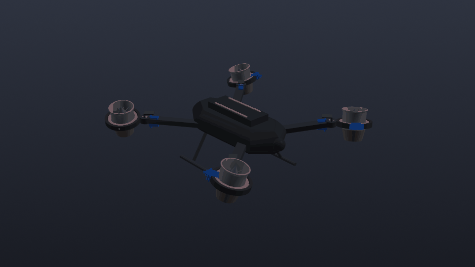
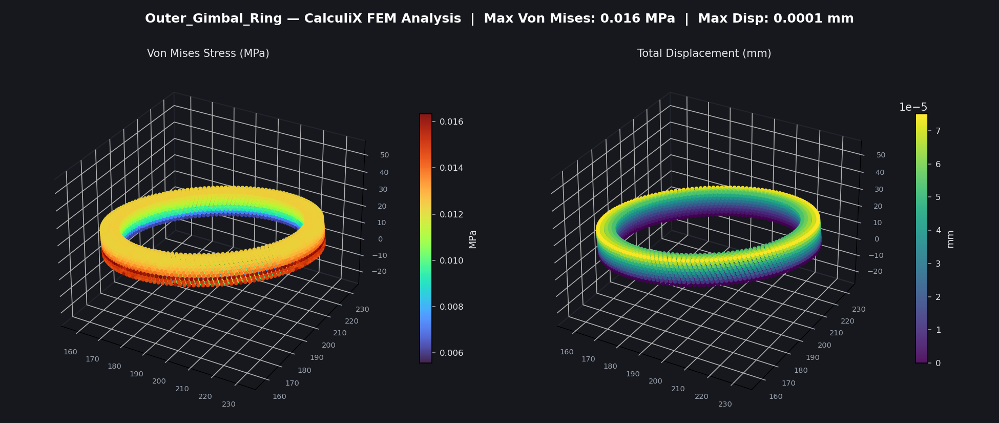
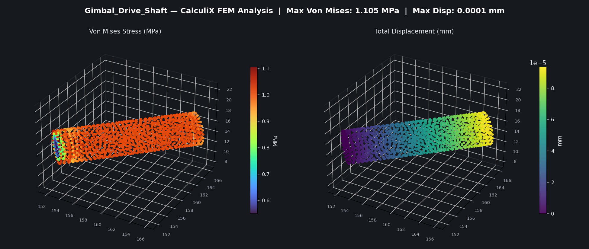

# Black Panther Quad-EDF VTOL Drone

<p align="center">
  
  
  
  
</p>

Parametric **FreeCAD 1.1+** CAD design, **2-axis thrust-vectoring animation**, **CalculiX (`ccx`) structural FEM analysis**, and **real-world Bill of Materials** for a **50 mm Quad-EDF VTOL Drone** ("Black Panther" stealth frame).

---

## Full-Parts 3D CAD Render

<p align="center">
  
</p>

## 4-Pod VTOL Thrust-Vectoring & Rotor Animation

<p align="center">
  
</p>

> Open `black_panther_quad_edf.FCStd` in FreeCAD and run `AnimateGimbalEDF.FCMacro` (**Macro → Macros...**) for the interactive **Play / Pause / Reset / Speed** controller.

---

## Design Architecture

- **4× 50 mm 2-Axis Gimbaled EDF Thrusters (`FL`, `FR`, `RL`, `RR`):**
  - Flared intake shroud (`50 mm` ID / `55 mm` OD), 11-blade rotor + spinner cone, and tapered exhaust nozzle (`-Z` vertical lift orientation).
  - **Inner Gimbal Ring** (orange, PA12-CF / PETG-CF) + **Outer Gimbal Ring** (black) with stainless pivot pins.
  - **Geared Actuation:** 14T/16T spur-geared vertical drive shaft, carbon-fiber L-bracket, and dual metal-gear micro servos (`EMAX ES08MA II` / `MG90S` class) per pod.
- **Black Panther Stealth VTOL Frame:**
  - Faceted center fuselage with solid capped top/bottom decks, nose sensor dome, dorsal battery canopy, orange accent trim, twin landing skids, and 4 swept carbon-fiber arms (`~551 mm` diagonal wheelbase).

---

## Structural FEM Analysis (Gmsh + CalculiX)

All key load-bearing parts were meshed with **Gmsh** (2nd-order 3D tetrahedral elements) and solved with **CalculiX (`ccx`)** under **20 N** per pod (~2× safety/gust factor on a 50 mm EDF) and **40 N** landing impact on the skids.

| Part | Material (`E`, Yield) | Mesh (Nodes / Elems) | Max Disp (mm) | Max Von Mises (MPa) | Safety Factor |
| :--- | :--- | :---: | :---: | :---: | :---: |
| `Panther_Arm_FL` | Carbon Fiber (`70 GPa`, `300 MPa`) | 2,713 / 1,345 | `0.0283` | `2.782` | **107.8** |
| `CF_Servo_Bracket` | Carbon Fiber (`70 GPa`, `300 MPa`) | 2,626 / 1,261 | `0.0719` | `21.020` | **14.3** |
| `Inner_Gimbal_Ring` | PETG / CF-Nylon (`2.5 GPa`, `50 MPa`) | 3,767 / 1,712 | `0.0001` | `0.024` | **2065.8** |
| `Outer_Gimbal_Ring` | PETG / CF-Nylon (`2.5 GPa`, `50 MPa`) | 4,761 / 2,174 | `0.0001` | `0.016` | **3061.2** |
| `Gimbal_Drive_Shaft` | 304 Stainless (`193 GPa`, `215 MPa`) | 1,666 / 857 | `0.0001` | `1.105` | **194.6** |
| `Panther_Landing_Skids` | Carbon Fiber (`70 GPa`, `300 MPa`) | 36,850 / 18,954 | *see note* | `7.034` | **42.7** |

> *Note:* `CF_Servo_Bracket` experiences the highest stress concentration (`21.020 MPa`, SF = 14.3) at the 2.2 mm L-bend. `Panther_Landing_Skids` contains two disconnected left/right skid assemblies in one compound, so the single-body solver exhibits a rigid-body mode on the unconstrained rail while still reporting local strut stress (`7.034 MPa`).

### Visual FEM Stress & Displacement Gallery

| Swept Carbon-Fiber Arm (`Panther_Arm_FL`) | Carbon-Fiber Servo Bracket (`CF_Servo_Bracket`) |
| :---: | :---: |
|  |  |

| Inner Gimbal Ring (`Inner_Gimbal_Ring`) | Outer Gimbal Ring (`Outer_Gimbal_Ring`) |
| :---: | :---: |
|  |  |

| Gimbal Drive Shaft (`Gimbal_Drive_Shaft`) | Landing Skids (`Panther_Landing_Skids`) |
| :---: | :---: |
|  |  |

---

## Real-World Build & Cost Estimate

Full hardware breakdown is documented in [`BOM_parts_list.md`](BOM_parts_list.md).

- **Propulsion:** 4× **FMS 50 mm V2 4500KV** / **Powerfun 4300KV** 4S 11-blade EDFs (**~3.8 – 4.3 kgf** combined static thrust)
- **ESCs:** 4× **45A–50A 4S BLHeli_32 / AM32**
- **Actuation:** 8× **EMAX ES08MA II** or **MG90S Metal-Gear** servos + dedicated **6V 5A–8A UBEC**
- **Flight Controller:** **Matek H743-Wing V3** (13 PWM outputs for 4 ESCs + 8 servos, ArduPilot)
- **Battery:** **4S 3300 mAh 60C–100C LiPo**
- **Estimated AUW:** **~1.45 – 1.55 kg** → **~2.5 : 1 Thrust-to-Weight Ratio**
- **Estimated Cost:** **~₹37,500 – ₹54,800 INR** (**~\$440 – \$670 USD**)

---

## Repository Structure

| File | Purpose |
| :--- | :--- |
| `build_gimbal_edf.py` | Parametric builder for a single 50 mm 2-axis gimbaled EDF (`gimbal_edf_50mm.FCStd` / `.step`) |
| `build_black_panther_quad.py` | Full 59-part VTOL quad-EDF assembly (`black_panther_quad_edf.FCStd` / `.step`) |
| `combine_black_panther_quad.py` | Exports unified single-object model (`black_panther_quad_edf_combined.FCStd` / `.step` / `.stl`) |
| `AnimateGimbalEDF.FCMacro` | FreeCAD GUI animation macro for 1-pod or 4-pod gimbal & rotor motion |
| `run_fem_tests.py` | Automated Gmsh + CalculiX FEM test suite |
| `render_fem_images.py` | Generates 3D Von Mises stress & displacement PNGs in `fem_results/` |
| `render_full_model_pic.py` | VTK offscreen 1920×1080 studio renderer (`black_panther_full_parts.png`) |
| `render_animation_gif.py` | VTK offscreen 960×540 looping GIF renderer (`black_panther_animation.gif`) |
| `BOM_parts_list.md` | Complete real-world parts list and thrust-to-weight budget |

---

## Quick Start (FreeCAD 1.1+)

```powershell
# 1. Regenerate CAD assemblies
freecadcmd.exe build_black_panther_quad.py
freecadcmd.exe combine_black_panther_quad.py

# 2. Run FEM analysis & render plots
freecadcmd.exe run_fem_tests.py
freecadcmd.exe render_fem_images.py

# 3. Render studio image & animation GIF
freecadcmd.exe render_full_model_pic.py
freecadcmd.exe render_animation_gif.py

# 4. Open animated assembly in FreeCAD GUI
freecad.exe black_panther_quad_edf.FCStd
```
